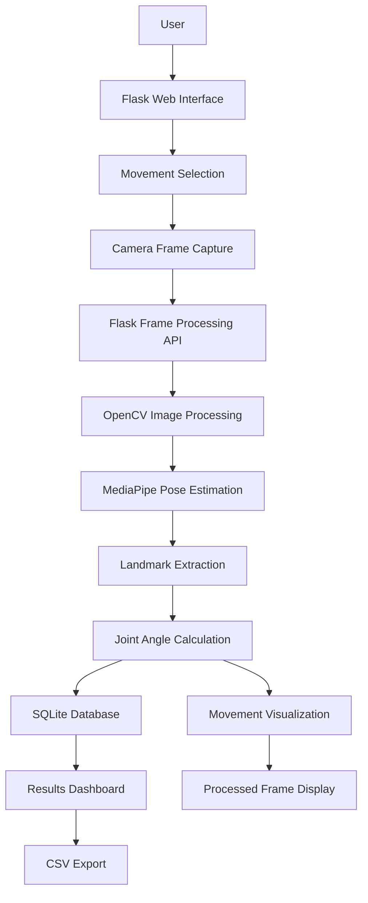

# PoseXplore – AI-Powered Human Pose & Joint Movement Analysis

**A computer vision-based posture and range-of-motion analysis application powered by MediaPipe Pose, OpenCV and Flask.**

PoseXplore is a human movement analysis platform designed to track joint movements, calculate angular measurements and record movement data through visual pose estimation.

The application uses computer vision and geometric calculations to analyze selected body movements, visualize joint landmarks and maintain historical measurement records.

---

## Overview

Understanding human movement and joint mobility is important in posture assessment, physical activity monitoring and rehabilitation-oriented applications.

PoseXplore explores how AI-powered pose estimation and computer vision can be used to measure human joint movements through a standard camera feed.

By combining MediaPipe Pose landmark detection, OpenCV image processing and mathematical angle calculations, the application provides a visual approach to monitoring selected joint movements and recording their range-of-motion measurements.

## Key Features

### 1. Human Pose Estimation
- Detects human body landmarks using MediaPipe Pose.
- Processes image frames using OpenCV.
- Identifies relevant anatomical reference points.
- Visualizes detected landmarks and connections.

### 2. Multi-Joint Movement Tracking

Supports multiple movement analysis functions:

| Body Region | Tracking Capabilities |
|---|---|
| Cervical Spine | Flexion, extension, lateral flexion and rotation |
| Thoraco-Lumbar Spine | Flexion, extension and bilateral lateral flexion |
| Shoulder | Left and right flexion and extension |
| Elbow | Left and right flexion |
| Axial Movement | Upward and downward deviation |

### 3. Joint Angle Calculation
- Calculates angles using detected body landmarks.
- Applies vector mathematics and reference lines.
- Tracks selected minimum and maximum angular measurements.
- Displays movement measurements on processed frames.

### 4. Visual Movement Monitoring
- Displays processed camera frames.
- Provides visual overlays for selected movements.
- Highlights relevant body landmarks and reference lines.
- Presents calculated angular measurements.

### 5. Measurement Persistence
- Stores movement measurements in SQLite.
- Maintains joint-specific minimum and maximum values.
- Records timestamps for measurement updates.
- Supports retrieval of previously recorded results.

### 6. Data Export
- Provides a results interface for stored measurements.
- Supports CSV export of tracking records.
- Allows recorded measurement data to be reviewed outside the application.

---

## Technology Stack

| Category | Technologies |
|---|---|
| Programming Language | Python |
| Backend Framework | Flask |
| Computer Vision | OpenCV |
| Pose Estimation | MediaPipe Pose |
| Mathematical Processing | NumPy |
| Image Processing | Pillow |
| Database | SQLite |
| Frontend | HTML, CSS, JavaScript |
| Deployment Configuration | Render, Gunicorn |

---

## System Architecture

PoseXplore follows a Flask-based application architecture with separate frontend templates, image-processing functions and persistent measurement storage.

### Architecture Diagram



### Architecture Components

**Presentation Layer**
- Flask HTML templates.
- User navigation and movement selection.
- Camera frame interaction.
- Processed movement visualization.

**Application Layer**
- Flask routing and request handling.
- Movement-specific function selection.
- Frame processing endpoints.
- Results retrieval and export.

**Computer Vision Layer**
- OpenCV image processing.
- MediaPipe Pose landmark detection.
- Body landmark extraction.
- Joint-angle calculations.

**Data Layer**
- SQLite database.
- Joint measurement records.
- Minimum and maximum angle storage.
- Timestamp-based record updates.

---

## How It Works

### Step 1 – Camera Frame Acquisition

The application receives image frames from the user interface for movement analysis.

### Step 2 – Image Processing

OpenCV prepares the image frames for pose estimation, including color-space conversion and image manipulation.

### Step 3 – Pose Estimation

MediaPipe Pose detects human body landmarks, including relevant shoulder, elbow, wrist, ear and hip reference points.

### Step 4 – Landmark Extraction

The application extracts the required landmark coordinates according to the selected movement.

### Step 5 – Joint Angle Calculation

Angular measurements are calculated using geometric relationships between body landmarks.

For three reference points A, B and C, the angle at B can be calculated using:

\[
\theta =
\cos^{-1}
\left(
\frac{(A-B)\cdot(C-B)}
{\|A-B\|\|C-B\|}
\right)
\]

The resulting angle is expressed in degrees.

### Step 6 – Movement Visualization

Calculated angles and selected landmark positions are displayed on the processed image frames.

### Step 7 – Data Storage

Selected measurement values are stored in SQLite for subsequent retrieval and review.

---

## Application Routes

The following application routes are implemented in the Flask backend.

| Endpoint | Method | Purpose |
|---|---|---|
| `/` | GET | Home page |
| `/home` | GET | Home page |
| `/main` | GET | Movement selection |
| `/more-options` | GET | Additional tracking options |
| `/track/<function_name>` | GET | Selected movement interface |
| `/process_frame/<function_name>` | POST | Process submitted image frames |
| `/video_feed/<function_name>/<display_mode>` | GET | Video feed endpoint |
| `/results` | GET | Display stored measurement records |
| `/download_csv` | GET | Export tracking records |

---

## Database Structure

PoseXplore uses SQLite for storing joint movement measurements.

### Table: `angle_data`

| Column | Data Type | Description |
|---|---|---|
| id | INTEGER | Tracking/session identifier |
| joint_name | TEXT | Name of the tracked movement |
| min_angle | REAL | Recorded minimum angle |
| max_angle | REAL | Recorded maximum angle |
| timestamp | TEXT | Last measurement update time |

The database is initialized automatically by the application when required.

---

## Project Structure

```text
PoseXplore/
│
├── static/
│   └── Frontend static resources and generated exports
│
├── templates/
│   └── Flask HTML templates
│
├── app.py
│   └── Main Flask application
│       ├── Pose estimation
│       ├── Joint movement tracking
│       ├── Angle calculations
│       ├── Image processing
│       ├── Database operations
│       └── Application routes
│
├── data-view.py
│   └── SQLite data inspection utility
│
├── angle_data.db
│   └── SQLite measurement database
│
├── requirements.txt
│   └── Python dependencies
│
├── render.yaml
│   └── Deployment configuration
│
└── README.md
    └── Project documentation
```

---

## Installation & Setup

### Prerequisites

- Python environment compatible with the pinned dependencies.
- pip package manager.
- Git.
- Camera/webcam for movement tracking.

### 1. Clone the Repository

```bash
git clone https://github.com/Ash-Geek8/PoseXplore.git

cd PoseXplore
```

### 2. Create a Virtual Environment

```bash
python -m venv venv
```

Activate the environment.

**Windows**

```bash
venv\Scripts\activate
```

**Linux / macOS**

```bash
source venv/bin/activate
```

### 3. Install Dependencies

```bash
pip install -r requirements.txt
```

### 4. Run the Application

```bash
python app.py
```

### 5. Access the Application

Open your browser:

```text
http://localhost:5000
```

---

## Application Workflow

1. Open the PoseXplore application.
2. Navigate to the movement selection interface.
3. Select the required body region and movement.
4. Provide camera frames through the application interface.
5. Observe detected landmarks and calculated angular measurements.
6. Review stored measurement results.
7. Export available records using CSV.

---

## Potential Applications

PoseXplore demonstrates computer vision techniques that can support research and prototyping in:

- **Posture Monitoring:** Exploring body alignment and movement patterns.
- **Physiotherapy Research:** Supporting experimental joint mobility measurement workflows.
- **Range-of-Motion Analysis:** Recording angular measurements during selected movements.
- **Sports and Fitness:** Exploring movement mechanics and joint mobility.
- **Ergonomics:** Studying selected posture-related movement patterns.

These are potential application areas, not validated clinical capabilities.

---

## Current Limitations

- Measurements depend on camera positioning, visibility and landmark detection quality.
- Occlusion and incorrect body positioning can affect angle calculations.
- Measurements are based on 2D image landmarks and do not provide full 3D biomechanical analysis.
- Joint-angle calculations are experimental and should not be treated as clinically validated measurements.
- Measurement reliability depends on consistent camera setup and movement execution.
- The application requires further testing for concurrent users and production deployment.

---

## Future Enhancements

The following improvements are potential development directions:

- Modularize the existing pose-processing architecture.
- Introduce improved landmark confidence validation.
- Implement temporal smoothing for more stable measurements.
- Add structured session management and historical comparisons.
- Improve visualization through interactive charts.
- Introduce PDF-based reporting.
- Extend tracking to additional joints and movement patterns.
- Improve application security and deployment architecture.
- Develop more comprehensive movement evaluation metrics.

---

## Disclaimer

PoseXplore is an experimental computer vision and movement analysis project developed for educational, research and prototyping purposes.

It is not a medical diagnostic system and does not replace professional medical assessment, physiotherapy guidance or clinically validated range-of-motion measurement equipment.

---

## Author

**Ashfaq Ahamed**

AI Engineer | Computer Vision | Python | Applied AI

GitHub: [Ash-Geek8](https://github.com/Ash-Geek8)

Project Repository: [PoseXplore](https://github.com/Ash-Geek8/PoseXplore)

---

*Exploring human movement through computer vision and intelligent pose estimation.*
